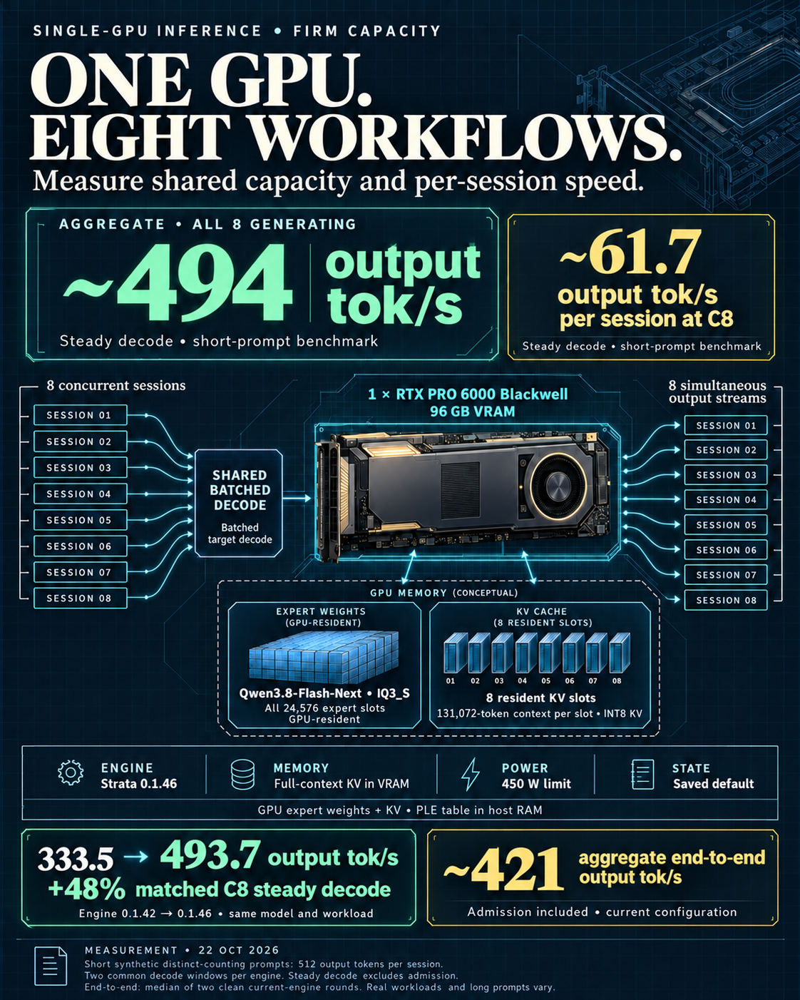

# Qwen3.8 on a single RTX PRO 6000

Independent deployment reports, reproducibility artifacts, and benchmark
receipts for running large Qwen3.8 models and related inference experiments on one
NVIDIA RTX PRO 6000 Blackwell Workstation Edition.

## Current recipe — October 22, 2026

The [eight-session Strata recipe](strata-c8/README.md) records the saved
Qwen3.8-Flash-Next IQ3_S profile: one 96 GB GPU, eight resident conversation
slots, 131,072-token context per slot, full INT8 KV residency, and Strata
engine 0.1.46. It includes the exact settings, model/runtime dependencies,
selected benchmark receipts, an HTTP benchmark harness, and the schematic.

| Short-prompt C8 measurement | Result |
| --- | ---: |
| Aggregate output throughput while all eight sessions generate | 493.7 tok/s |
| Output throughput per session over the same common window | 61.7 tok/s |
| Matched steady-decode improvement over engine 0.1.42 profile | +48.0% |
| Current-profile aggregate whole-request output throughput, admission included | 421.4 tok/s |

Eight distinct synthetic counting prompts, 512 output tokens per session,
two common decode windows per engine. Steady rates exclude admission; the
whole-request result is the median of two clean current-profile rounds.
The +48% applies to matched steady decode only. The configured context capacity
is separate from this short-prompt speed test; real workloads vary.

For shared firm infrastructure, report aggregate capacity together with
per-session responsiveness and prompt-admission behavior. This recipe measures
eight actual concurrent streams rather than multiplying a single-stream result.

## Recent experiments — updated October 15, 2026

The [experiment archive](experiments/README.md) covers the work since the
September release: SGLang/NVIDIA checkpoint tuning, LoRA and recurrent-memory
research, TensorFold, eight-slot Strata, batched MTP, KV streaming, d1
decisions, and LFM2.5 smoke/accounting tests. It includes failed and interrupted
trials, selected source receipts, exact scope limits, and an offline validator.

| Finding | Evidence |
| --- | --- |
| KV streaming freed 10.37 GiB startup VRAM while retaining 128K context | [Memory profiles](experiments/MEMORY-PROFILES.md) |
| Batched MTP passed parity but its best matched pair remained 4.83% slower | [Strata and MTP](experiments/STRATA-AND-MTP.md) |
| LFM passed 14/14 short checks; initial long accounting suite had 0/16 exact passes; corrected rerun was partial | [LFM2.5](experiments/LFM25.md) |
| d1 direct visual worker passed 10/10; the capture/tool bridge remained unresolved | [Decision models](experiments/D1-DECISIONS.md) |

Results are dated observations, not a current deployment prescription or a
cross-model leaderboard. [Provenance and limitations](experiments/PROVENANCE.md)
distinguish selected machine receipts from historical notebook records.

## Reports

| Deployment | Result | Report and artifacts |
| --- | --- | --- |
| Qwen3.8-Flash-Next NVFP4 with a signed-W4 host PLE sidecar | 125B main model plus a 51.2 GB PLE table reduced to 28.8 GB; qualified at 131K context; later combined device caching, native MTP/EAGLE, and ReplaySSM | [Implementation, source, receipts, PDF, and production addenda](flash-next-w4-ple/) |
| Qwen3.8-27B NVFP4 with DSpark | 119.19 output tok/s over the validated 8x workload | [Eight-page PDF](Qwen3.8-27B-NVFP4-DSpark-RTX-PRO-6000-Full-Report.pdf) |

The Flash-Next package preserves the earlier SGLang deployment. It includes
the exact downstream SGLang patches, sidecar builder and loader, safe serving
example, validation evidence, scoped licenses, and the long-form PDF. Its
28.8 GB binary companion is published at
[`Lewfkrad/Qwen3.8-Flash-Next-NVFP4-W4-PLE`](https://huggingface.co/Lewfkrad/Qwen3.8-Flash-Next-NVFP4-W4-PLE),
with the complete verified artifact and final attribution card at Hub revision
`8bf4dd3779b15732b303c0931e64961a332a0c78`.

Independent contributors can use the
[`portable review handoff`](flash-next-w4-ple/NICHO-HANDOFF.md) to work from
their own GitHub and Codex accounts without access to the live deployment.

### 2026-09-01 cached NEXTN + ReplaySSM addendum

The September 1 qualified field profile combines device radix caching with the
checkpoint's native shallow NEXTN/MTP path, ReplaySSM speculative-state
management, and full decode graphs for batch sizes 1-4. Against a fresh
same-day cached/no-speculation control, forced-512 decode medians improved from
97.882 to 144.563 tok/s at c1, 185.666 to 255.986 aggregate tok/s at c2, and
332.794 to 434.883 aggregate tok/s at c4.

The
[`September 1 production addendum`](flash-next-w4-ple/docs/CACHED-NEXTN-REPLAYSSM-PRODUCTION-ADDENDUM-2026-09-01.md)
contains the exact profile, paired performance table, cache/branch/workload
gates, minimized public receipts, and causal limits. Promotion requalified the
profile but did not rerun throughput; it was probationary at publication.

On September 2, the live deployment advanced from EAGLE/NEXTN `1/1/2` to a
guarded `2/1/3` depth after a separate depth-only A/B. That later operational
change is not part of this September 1 evidence bundle; the measurements and
receipts here remain date-bounded to the qualified `1/1/2` profile.

### 2026-08-27 production addendum

The original publication captured the conservative non-speculative 131K
profile. A later controlled promotion enabled the checkpoint's native
one-layer MTP head with EAGLE 1-1-2 and rejection sampling. Post-promotion
greedy medians were 133.545 tok/s at c1, 233.049 aggregate tok/s at c2, and
389.299 aggregate tok/s at c4. The complete flags, memory envelope, quality and
long-context results, caveats, and new raw receipts are in the
[`MTP/EAGLE production addendum`](flash-next-w4-ple/docs/MTP-EAGLE-PRODUCTION-ADDENDUM-2026-08-27.md).

For future model bring-ups, we are evaluating
[`SouthpawIN/turbofit`](https://github.com/SouthpawIN/turbofit) as an isolated
hardware-inventory, engine-audition, and evidence-campaign framework. It is not
part of this runtime or fleet, and its stock routing/catalog policy must not be
treated as a production configuration without a separate review.

## Qwen3.8-27B NVFP4 + DSpark report

This earlier report covers the official SGLang Qwen3.8-27B NVFP4 + DSpark
serving recipe on the same GPU class.

### Validated result

The clean benchmark used SGLang's OpenAI-compatible serving benchmark with a
random dataset, 8,192 input tokens, 1,024 output tokens, eight requests,
concurrency 1, and a cache flush.

| Metric | Result |
| --- | ---: |
| Successful requests | 8 / 8 |
| Input / output tokens | 65,536 / 8,192 |
| Benchmark duration | 68.73 s |
| Output throughput | 119.19 tok/s |
| Total throughput | 1,072.69 tok/s |
| Mean TTFT | 729.82 ms |
| Mean TPOT | 7.68 ms |
| DSpark accept length | 2.50 |

Single-request server decode windows exceeded 206 tok/s and reached 265.67
tok/s when DSpark acceptance was higher. Those windows are not equivalent to
the full random-workload average.

### Configuration highlights

- ModelOpt NVFP4 target with FP8 E4M3 KV cache
- DSpark gamma 7 and verification width 8
- FlashInfer target and draft attention
- FP32 GDN state with `extra_buffer`
- Decode, prefill, and verification CUDA graphs
- 2,048-token chunked prefill
- Qwen3 reasoning and tool-call parsers
- Workload-sized Mamba full-memory ratio: `6.626953125`
- Effective validated KV pool: 196,618 tokens

The checkpoint advertises a native 262,144-token maximum. The validated
workload-sized memory ratio does not establish that the full native window is
available under this serving profile; recalculate and revalidate before making
that claim or increasing concurrency.

### Reproducibility pins

- Target: `RadixArk/Qwen3.8-27B-NVFP4`
  - revision `554ebba9b5f1b79dc11246341960360e6ef05ef4`
- Draft: `RadixArk/Qwen3.8-27B-DSpark`
  - revision `85ef153be924f17ce4bf62726954eeaa4a73e854`
- SGLang image: `lmsysorg/sglang:qwen38-27b`
  - AMD64 manifest `sha256:506525a5907ea22c9d445afb7c03603959b912de034d86915cf17da814f1a124`
- FlashInfer Python source commit:
  `906181e3f4cf4bcc81835fb480db4011bbd80b62`

### References

- [SGLang Qwen3.8-27B cookbook](https://docs.sglang.io/cookbook/autoregressive/Qwen/Qwen3.8-27B)
- [SGLang Qwen3.8 configuration source](https://github.com/sgl-project/sglang/blob/main/docs/src/snippets/configs/Qwen/qwen3.8-27b.jsx)
- [Community Qwen3.8 MTP project](https://github.com/sudoingX/qwen38-mtp)

## Integrity and independence

Published PDF SHA-256 digests are recorded in
[`CHECKSUMS.txt`](CHECKSUMS.txt). The Flash-Next subtree has its own complete
[`SHA256SUMS`](flash-next-w4-ple/SHA256SUMS) receipt.

This is an independent technical report and is not an official publication of
Alibaba Qwen, SGLang, NVIDIA, RadixArk, or FlashInfer.
