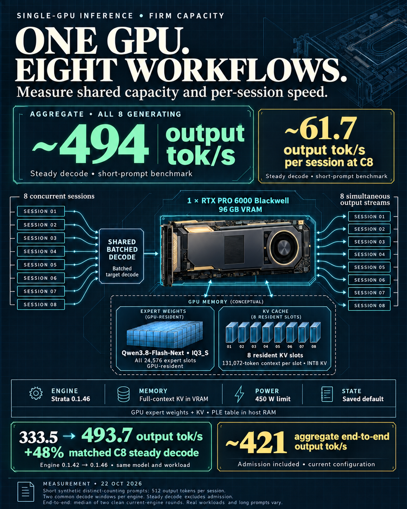

<!-- project-home:start -->


**[One RTX PRO 6000 · Blackwell Inference Lab](https://lewfkrad.github.io/rtx-pro-6000-inference-lab/)** · [Documentation](https://github.com/lEWFkRAD/rtx-pro-6000-inference-lab/blob/Cloud1/README.md)

Single-GPU Blackwell inference reports, bit-exact CUDA kernel patches, speculative decoding & zero-backprop RSI experiments, and reproducible benchmark receipts across **Inkling-2-Mini**, **Qwen3.8**, and custom Basalt/Strata builds.

<!-- project-home:end -->

# One RTX PRO 6000 · Blackwell Inference Lab

Independent single-GPU inference engineering, bit-exact CUDA kernel tuning,
speculative decoding, zero-backprop loop-dynamics RSI, and benchmark receipts
on one **NVIDIA RTX PRO 6000 Blackwell Workstation Edition (96 GB)** — spanning
**Inkling-2-Mini** (`thinkingmachines/Inkling-2-Mini`, #1 Verified Overall on
LocalMaxxing at **571.3 tok/s** and #1 Reasoning at **528.2 tok/s**), **Qwen3.8-Flash-Next** (#1 and #2 Verified on
LocalMaxxing), and custom Basalt / Strata serving stacks.


<!-- inkling2-mini-basalt-20261127:start -->
## November 28 — Inkling 2 Mini `turbo5` (599.6 / 565.9 tok/s, 65.7 ms TTFT) + #1 Overall Verified (`turbo4` 571.3 / 528.2) + RSI-v3 & DSpark Self-Distillation

Built and promoted a **100% cross-build bit-exact** custom Basalt 0.5.6 build series (`graphfix` → `turbo` → `turbo2` → `turbo3` → `turbo4` → **`pinned-20261128-turbo5`**, now LIVE on 12×262K production) on one **NVIDIA RTX PRO 6000 Blackwell Workstation Edition (96 GB, stock 500 W)** for `thinkingmachines/Inkling-2-Mini`:
- **NEW `pinned-20261128-turbo5` (LIVE in Production, LocalMaxxing Dry-Run Validated — `valid: true, verified: true, issues: []`, 0 SM120 spills):**
  - 6-part bit-exact SM120 prefill/TTFT suite (`moe_fp4::gemm_kernel_128_smallM` 4× occupancy, `q8::gemm_t<32,1,4>` + 256-entry `TmaDesc` cache + 3-act Q/K/V fusion `-128` launches, parallel-warp `ctrl_down_prompt_3x` 12× CTA grid, `attn_prompt_kernel<FP8, 16>` 3.8× grid, `16×16` router dot 7.5× grid) + automatic VRAM placement of `token_embd.weight` (`0.86 GiB`, funded by ECC OFF's `+2.7 GiB` headroom).
  - **`code-v1` (`fp16 KV`, ECC OFF, dry-run valid):** **599.6 tok/s** p50 (sample max `608.7`, **+28.3 tok/s** vs `turbo4` #1), **`3,697.7`** client / **`5,072.2 tok/s`** engine prefill (`+32.1%`), **`65.72 ms`** client TTFT / **`48.5 ms`** engine pp (`-11.42 ms` / `-13.5 ms`).
  - **`reasoning-v1` (`fp16 KV`, ECC OFF, dry-run valid):** **565.9 tok/s** p50 (sample max `580.5`, **+37.7 tok/s** vs `turbo4` #1), **`4,435.6`** client / **`5,935.6 tok/s`** engine prefill (`+20.3%`), **`66.22 ms`** client TTFT / **`49.7 ms`** engine pp (`-12.12 ms` / `-10.3 ms`).
- **#1 Overall & #1 `code-v1` Verified Live (`turbo4`):** **571.3 tok/s** (`fp16 KV`, ECC ON, 201/249 DSpark, `77.14 ms` TTFT, [cmx02xkd9005enp01vnscl239](https://www.localmaxxing.com/en/speed-tests/cmx02xkd9005enp01vnscl239)) — **+18.7 tok/s** over our prior `turbo2` #1 (`552.6`), **+45.1 tok/s** ahead of `#2` RTX 5090 (`526.2`), and **+72.1 tok/s** ahead of RTX PRO 6000 Server 600 W (`499.2`).
- **#1 `reasoning-v1` Verified Live (`turbo4`):** **528.2 tok/s** (`fp16 KV`, ECC OFF, 190/259 DSpark, `78.34 ms` TTFT, [cmx0gxgwt00hznp012nbiul6l](https://www.localmaxxing.com/en/speed-tests/cmx0gxgwt00hznp012nbiul6l); prior ECC-ON `522.2` at [cmx02ucbe005anp01xq9m1iox](https://www.localmaxxing.com/en/speed-tests/cmx02ucbe005anp01xq9m1iox)) — **+14.7 tok/s** over our prior `turbo2` #1 (`513.5`), **+39.6 tok/s** ahead of the fastest RTX 5090 (`488.6`), and **+62.4 tok/s** ahead of RTX PRO 6000 Server 600 W (`465.8`).
- **Prior `turbo2` Verified Benchmarks:** `552.6 tok/s` `code-v1` ([cmwzqhlba000drv01oxl1qyx4](https://www.localmaxxing.com/en/speed-tests/cmwzqhlba000drv01oxl1qyx4)), `513.5 tok/s` `reasoning-v1` ([cmwzqhm7g000grv01t8z2axgq](https://www.localmaxxing.com/en/speed-tests/cmwzqhm7g000grv01t8z2axgq)), plus FP8-KV `494.6` / `467.1 tok/s` ([cmwzptydq0007rv01ilvkhn1z](https://www.localmaxxing.com/en/speed-tests/cmwzptydq0007rv01ilvkhn1z), [cmwzptz4z000arv01ozwma02c](https://www.localmaxxing.com/en/speed-tests/cmwzptz4z000arv01ozwma02c)).
- **12×262K Production Multi-Slot (`fp8 KV`):** **1,049.5 tok/s** (`turbo`) / **936.6 tok/s** (`turbo2`) across 12 slots (`batch_identity.py`, 100% cross-build bit-exact vs `gf_q8.json`, 0 failures across all GPU parity suites) + **-25–29%** multi-slot TTFT from `BGEN` admission reuse + batch-mode DSMEM `attn_fused_kernel` + live `turbo5` VRAM embeddings (`90,101 / 97,887 MiB`, `7,218 MiB` free).
- **Surgical Local `RSI-v3` + Q8-Coda Recovery + Lossless On-Policy DSpark Self-Distillation:**
  - Fixed a hidden MXFP8 coda repacking regression (`type 46` → verbatim `type 8 Q8_0`, recovering **+16.8%** multi-slot throughput), restored exact `final_logit_softcapping=30.0` in GSPO, froze prelude `L0–L5` (preserving DSpark Visit 5 at `cos = 1.0000`), and trained only `326` BF16/FP32 loop-control/attention tensors (0 MoE experts modified) on a `K=6` @ `3072` hard frontier.
  - **`RSI-v3`** swept the strictly unseen 96-problem blind holdout (`64 blind_dsr_hard + 32 ab_math`) + 4 Hermes tools: **78/96 (81.2%, +6.2 pp vs Original 72/96)**, **`0.0%` repetition** (down from `4.2%`), `4/4` tools, `-31.6%` fewer 2048-token caps (`19 → 13`), and `-16.7%` shorter completions (`793.7` vs `952.9` tok).
  - **22.9-Second On-Policy DSpark Self-Distillation (100% Lossless):** Built an exact PyTorch DSpark replica (`0.999766` logit cosine vs Basalt `--diag-dump dspark.bin`) and distilled on 210 diverse on-policy trajectories with NVFP4-aware differential LRs, lifting real `turbo4` batch-8 DSpark acceptance **`85.8% → 87.8%` (+2.0 pp, `w_dl=1.998`)**, live aggregate throughput **`724 → 821 tok/s` (+13.4%, beating Original's `812.5 tok/s`)**, and Blind96 wall-clock time to **`91.0 s`** (**14.7 s faster than Original**) with exact identical outputs.

[Full results, `turbo2`–`turbo5` patches, charts, and raw receipts](research/inkling2-mini-basalt-20261127/RESULTS.md) · [8-Page Full-Stack Hillclimb PDF Report (`Stock → turbo5`)](research/inkling2-mini-basalt-20261127/Inkling-2-Mini-RTX-PRO-6000-Hillclimb-Report-2026-11-28.pdf) · [4-Page RSI-v3 & DSpark Distillation PDF Report](research/inkling2-mini-basalt-20261127/Inkling2-Mini-RSI-v3-DSpark-Hillclimb-Report-20261128.pdf).
<!-- inkling2-mini-basalt-20261127:end -->


<!-- localmaxxing-leaderboard:start -->
## November 14 — localmaxxing.com leaderboard, rank 1 and 2 of 806

Two Verified speed-test submissions hold the top two published runs for
Qwen3.8-Flash-Next: 414.6 tokens/s with the DFlash2 drafter and 413.4 tokens/s
plain, canonical prompt, measured against the live production endpoint with no
restart. A KV-cache sweep shows 99.95% prompt-token reuse at every context
length from 10K to 80K, with TTFT under 474 ms at 80K. The next published
Strata IQ3_S entry is 161.1 tokens/s on a multi-GPU rig.
[Results, receipts and the published report](research/localmaxxing-20261114/RESULTS.md).
The same evidence is upstream as discovery evidence in
[Turbofit PR #83](https://github.com/SouthpawIN/turbofit/pull/83).
<!-- localmaxxing-leaderboard:end -->


<!-- strata-context-262k:start -->
## November 3 — 262K production context

The production default now configures eight 262,144-token sessions with resident
INT8 KV, all 24,576 GPU experts, matched vision and 8,192-token prefill chunks.
Seven normal production canaries passed, including a 259,999-token request and
its repeated prefix. Full eight-way deep generation remains unqualified; the
operator explicitly approved this default after those test limits were reported.
[Results, deployment and full test data](research/strata-context-262k/RESULTS.md).
A later credential update is approved and live; fresh recovery checks passed.
[Recovery record](research/strata-context-262k/outage-20261104/INCIDENT.md).
<!-- strata-context-262k:end -->


## November 3 — stock Strata 0.1.56 benchmark and tuning

The [stock-engine benchmark package](research/strata-0156-tuning/) contains the
selected serving profile, code, tests and complete synthetic receipts. Three
matched alternating pairs measured eight-stream whole-request throughput of
369.7 versus 412.6 tokens/s (+11.6%) and a 125K-token retrieval request at
16.87 versus 14.92 seconds. A separate API spot measured +23.9% on its 4K-input
workload. Capacity remains eight × 131,072; known arithmetic failures remain.
[Results and limitations](research/strata-0156-tuning/RESULTS.md). The selected
profile was subsequently promoted on November 3 (November 4 UTC), with normal
readiness and all six production feature checks passing. See the
[deployment record](research/strata-0156-tuning/PROMOTION.md). LSA remains deferred.

## November 3 research — native Strata LSA

The [native LSA research package](research/strata-lsa/) includes the optional
learned attention selector, source patches, calibration maps, training code,
test receipts and complete source/data release downloads. Integration and
bounded compatibility checks are complete; context remains 131,072 tokens.
The candidate was **not promoted**: the eight-slot smoke measured 296.5 versus
414.6 rows/s for the control. [Results and limitations](research/strata-lsa/native/INTEGRATION-RESULTS.md).

## Featured release — Strata Lens 0.1.0-preview.1

Strata Lens adds a local, live view of capture runs to this repository's
experimental Qwen3.8 residual and expert-routing harness. Follow run status,
inspect artifact metadata and see the recorded provenance without starting a
model from the browser. The dashboard uses Python's standard library, binds to
loopback and refreshes every two seconds.

[GitHub prerelease](https://github.com/lEWFkRAD/rtx-pro-6000-inference-lab/releases/tag/strata-lens-v0.1.0-preview.1) ·
[Full release write-up](research/strata-lens/RELEASE.md) ·
[Quickstart and capture guide](research/strata-lens/README.md) ·
[Credits and provenance](research/strata-lens/CREDITS.md)

Try the explicitly synthetic demo from the repository root:

```bash
python3 research/strata-lens/lens_ui.py --demo
```

Open **http://127.0.0.1:8765**. To watch your own capture directory instead,
run `python3 research/strata-lens/lens_ui.py --runs-dir /path/to/runs`.
Neither command launches Strata, uses the GPU or changes a model service.

This is an **experimental prerelease**, not an upstream Strata release.
The harness has offline and fake-engine tests; a real GPU capture remains
pending. The UI displays recorded success and metadata, not independently
validated model behavior. It is not a neuron visualizer or a steering console.

### Current saved configuration — October 25, 2026

The [October 25 configuration snapshot](strata-c8/CURRENT-CONFIG-2026-10-25.md)
publishes the current saved settings separately from the measured recipe below:
prefill 32,768 and output-budget fitting enabled. The source service was
failing readiness when inspected; this snapshot is not a new qualification or
speed result.

## Qualified recipe — October 22, 2026



The [eight-session Strata recipe](strata-c8/README.md) records the saved
Qwen3.8-Flash-Next IQ3_S profile: one 96 GB GPU, eight resident conversation
slots, 131,072-token context per slot, full INT8 KV residency, and Strata
engine 0.1.46. It includes the exact settings, model/runtime dependencies,
selected benchmark receipts, an HTTP benchmark harness, and the schematic.

| Short-prompt C8 measurement | Result |
| --- | ---: |
| Aggregate output throughput while all eight sessions generate | 493.7 tok/s |
| Output throughput per session over the same common window | 61.7 tok/s |
| Matched steady-decode improvement over engine 0.1.42 profile | +48.0% |
| Current-profile aggregate whole-request output throughput, admission included | 421.4 tok/s |

Eight distinct synthetic counting prompts, 512 output tokens per session,
two common decode windows per engine. Steady rates exclude admission; the
whole-request result is the median of two clean current-profile rounds.
The +48% applies to matched steady decode only. The configured context capacity
is separate from this short-prompt speed test; real workloads vary.

For shared firm infrastructure, report aggregate capacity together with
per-session responsiveness and prompt-admission behavior. This recipe measures
eight actual concurrent streams rather than multiplying a single-stream result.

## Recent experiments — updated October 15, 2026

The [experiment archive](experiments/README.md) covers the work since the
September release: SGLang/NVIDIA checkpoint tuning, LoRA and recurrent-memory
research, TensorFold, eight-slot Strata, batched MTP, KV streaming, d1
decisions, and LFM2.5 smoke/accounting tests. It includes failed and interrupted
trials, selected source receipts, exact scope limits, and an offline validator.

| Finding | Evidence |
| --- | --- |
| KV streaming freed 10.37 GiB startup VRAM while retaining 128K context | [Memory profiles](experiments/MEMORY-PROFILES.md) |
| Batched MTP passed parity but its best matched pair remained 4.83% slower | [Strata and MTP](experiments/STRATA-AND-MTP.md) |
| LFM passed 14/14 short checks; initial long accounting suite had 0/16 exact passes; corrected rerun was partial | [LFM2.5](experiments/LFM25.md) |
| d1 direct visual worker passed 10/10; the capture/tool bridge remained unresolved | [Decision models](experiments/D1-DECISIONS.md) |

Results are dated observations, not a current deployment prescription or a
cross-model leaderboard. [Provenance and limitations](experiments/PROVENANCE.md)
distinguish selected machine receipts from historical notebook records.

## Reports

| Deployment | Result | Report and artifacts |
| --- | --- | --- |
| Qwen3.8-Flash-Next NVFP4 with a signed-W4 host PLE sidecar | 125B main model plus a 51.2 GB PLE table reduced to 28.8 GB; qualified at 131K context; later combined device caching, native MTP/EAGLE, and ReplaySSM | [Implementation, source, receipts, PDF, and production addenda](flash-next-w4-ple/) |
| Qwen3.8-27B NVFP4 with DSpark | 119.19 output tok/s over the validated 8x workload | [Eight-page PDF](Qwen3.8-27B-NVFP4-DSpark-RTX-PRO-6000-Full-Report.pdf) |

The Flash-Next package preserves the earlier SGLang deployment. It includes
the exact downstream SGLang patches, sidecar builder and loader, safe serving
example, validation evidence, scoped licenses, and the long-form PDF. Its
28.8 GB binary companion is published at
[`Lewfkrad/Qwen3.8-Flash-Next-NVFP4-W4-PLE`](https://huggingface.co/Lewfkrad/Qwen3.8-Flash-Next-NVFP4-W4-PLE),
with the complete verified artifact and final attribution card at Hub revision
`8bf4dd3779b15732b303c0931e64961a332a0c78`.

Independent contributors can use the
[`portable review handoff`](flash-next-w4-ple/NICHO-HANDOFF.md) to work from
their own GitHub and Codex accounts without access to the live deployment.

### 2026-09-01 cached NEXTN + ReplaySSM addendum

The September 1 qualified field profile combines device radix caching with the
checkpoint's native shallow NEXTN/MTP path, ReplaySSM speculative-state
management, and full decode graphs for batch sizes 1-4. Against a fresh
same-day cached/no-speculation control, forced-512 decode medians improved from
97.882 to 144.563 tok/s at c1, 185.666 to 255.986 aggregate tok/s at c2, and
332.794 to 434.883 aggregate tok/s at c4.

The
[`September 1 production addendum`](flash-next-w4-ple/docs/CACHED-NEXTN-REPLAYSSM-PRODUCTION-ADDENDUM-2026-09-01.md)
contains the exact profile, paired performance table, cache/branch/workload
gates, minimized public receipts, and causal limits. Promotion requalified the
profile but did not rerun throughput; it was probationary at publication.

On September 2, the live deployment advanced from EAGLE/NEXTN `1/1/2` to a
guarded `2/1/3` depth after a separate depth-only A/B. That later operational
change is not part of this September 1 evidence bundle; the measurements and
receipts here remain date-bounded to the qualified `1/1/2` profile.

### 2026-08-27 production addendum

The original publication captured the conservative non-speculative 131K
profile. A later controlled promotion enabled the checkpoint's native
one-layer MTP head with EAGLE 1-1-2 and rejection sampling. Post-promotion
greedy medians were 133.545 tok/s at c1, 233.049 aggregate tok/s at c2, and
389.299 aggregate tok/s at c4. The complete flags, memory envelope, quality and
long-context results, caveats, and new raw receipts are in the
[`MTP/EAGLE production addendum`](flash-next-w4-ple/docs/MTP-EAGLE-PRODUCTION-ADDENDUM-2026-08-27.md).

For future model bring-ups, we are evaluating
[`SouthpawIN/turbofit`](https://github.com/SouthpawIN/turbofit) as an isolated
hardware-inventory, engine-audition, and evidence-campaign framework. It is not
part of this runtime or fleet, and its stock routing/catalog policy must not be
treated as a production configuration without a separate review.

## Qwen3.8-27B NVFP4 + DSpark report

This earlier report covers the official SGLang Qwen3.8-27B NVFP4 + DSpark
serving recipe on the same GPU class.

### Validated result

The clean benchmark used SGLang's OpenAI-compatible serving benchmark with a
random dataset, 8,192 input tokens, 1,024 output tokens, eight requests,
concurrency 1, and a cache flush.

| Metric | Result |
| --- | ---: |
| Successful requests | 8 / 8 |
| Input / output tokens | 65,536 / 8,192 |
| Benchmark duration | 68.73 s |
| Output throughput | 119.19 tok/s |
| Total throughput | 1,072.69 tok/s |
| Mean TTFT | 729.82 ms |
| Mean TPOT | 7.68 ms |
| DSpark accept length | 2.50 |

Single-request server decode windows exceeded 206 tok/s and reached 265.67
tok/s when DSpark acceptance was higher. Those windows are not equivalent to
the full random-workload average.

### Configuration highlights

- ModelOpt NVFP4 target with FP8 E4M3 KV cache
- DSpark gamma 7 and verification width 8
- FlashInfer target and draft attention
- FP32 GDN state with `extra_buffer`
- Decode, prefill, and verification CUDA graphs
- 2,048-token chunked prefill
- Qwen3 reasoning and tool-call parsers
- Workload-sized Mamba full-memory ratio: `6.626953125`
- Effective validated KV pool: 196,618 tokens

The checkpoint advertises a native 262,144-token maximum. The validated
workload-sized memory ratio does not establish that the full native window is
available under this serving profile; recalculate and revalidate before making
that claim or increasing concurrency.

### Reproducibility pins

- Target: `RadixArk/Qwen3.8-27B-NVFP4`
  - revision `554ebba9b5f1b79dc11246341960360e6ef05ef4`
- Draft: `RadixArk/Qwen3.8-27B-DSpark`
  - revision `85ef153be924f17ce4bf62726954eeaa4a73e854`
- SGLang image: `lmsysorg/sglang:qwen38-27b`
  - AMD64 manifest `sha256:506525a5907ea22c9d445afb7c03603959b912de034d86915cf17da814f1a124`
- FlashInfer Python source commit:
  `906181e3f4cf4bcc81835fb480db4011bbd80b62`

### References

- [SGLang Qwen3.8-27B cookbook](https://docs.sglang.io/cookbook/autoregressive/Qwen/Qwen3.8-27B)
- [SGLang Qwen3.8 configuration source](https://github.com/sgl-project/sglang/blob/main/docs/src/snippets/configs/Qwen/qwen3.8-27b.jsx)
- [Community Qwen3.8 MTP project](https://github.com/sudoingX/qwen38-mtp)

## Integrity and independence

Published PDF SHA-256 digests are recorded in
[`CHECKSUMS.txt`](CHECKSUMS.txt). The Flash-Next subtree has its own complete
[`SHA256SUMS`](flash-next-w4-ple/SHA256SUMS) receipt.

This is an independent technical report and is not an official publication of
Alibaba Qwen, SGLang, NVIDIA, RadixArk, or FlashInfer.

<!-- strata-session-speed:start -->
## November 4 — per-session generation-speed screen

The unchanged eight-session, 262K production configuration completed two
ordinary C8 baseline rounds at 49.2 and 53.0 tokens/s per session, including
prompt processing and API overhead. All eight slots generated together for
about 18 seconds on 1.2–2.2K-token prompts with 1024 output tokens each.
These are new baseline measurements, not a tuning gain or eight deep-context
qualification. Neither confidence-floor alternative earned promotion.
[Method, code and complete results](research/strata-session-speed/RESULTS.md).
<!-- strata-session-speed:end -->
