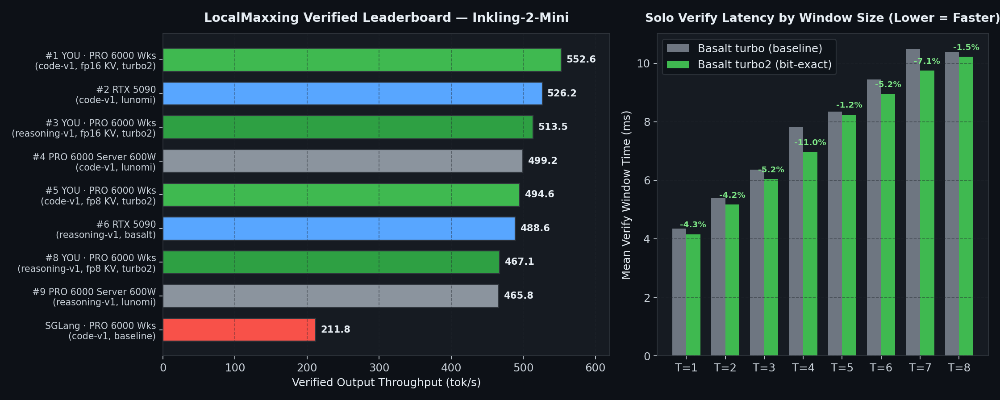
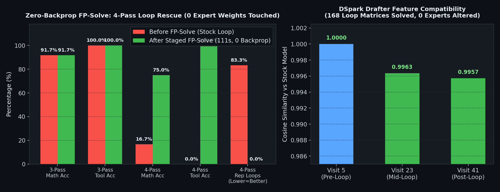
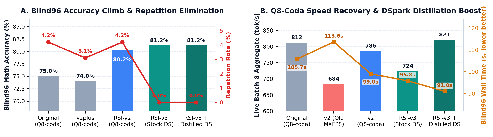
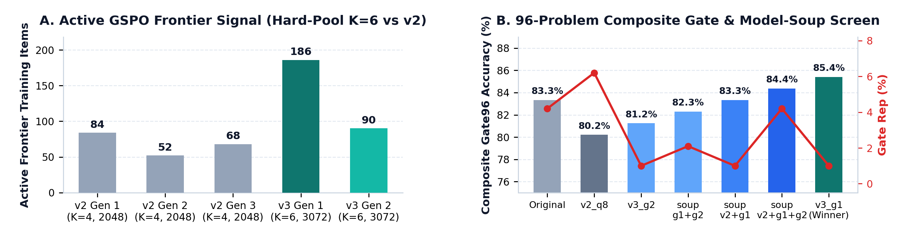
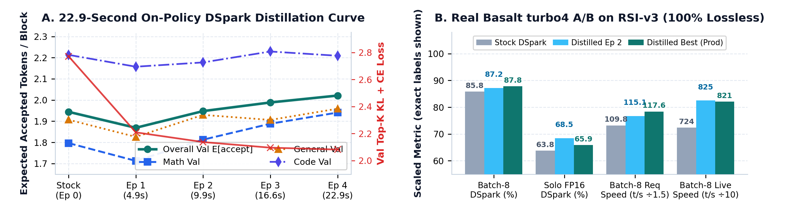

# November 27 — Inkling 2 Mini on one RTX PRO 6000 (Basalt 12×262K, bit-exact turbo)

Production deployment and controlled A/B optimization of **Inkling 2 Mini** (`NVFP4` experts + `Q8_0` dense/head + `DSpark` drafter) served via **Basalt** on a single **NVIDIA RTX PRO 6000 Blackwell Workstation Edition (96 GB)** with **12 resident 262,144-token slots** and **FP8 KV cache**.

The promoted `pinned-20261127-turbo` binary (`sha256: 915b1e0f4e85528c45a694fc30f89a3b59027e00a8d48de010e6746224e97834`) is **100% cross-build bit-exact** with `pinned-20261127-graphfix` across 4-, 8-, and 12-slot `batch_identity.py` verification while improving isolated HTTP throughput by **+1.2% to +6.2%** (up to **+7.8%** pre-soak on sampled `N=8`) and cutting multi-slot worst-case TTFT by **25–29%**.

## Hardware & Production Configuration

- **GPU:** 1× NVIDIA RTX PRO 6000 Blackwell Workstation Edition (97,887 MiB VRAM, 188 SMs, SM120, 500 W cap)
- **Model pack:** `Inkling-2-Mini-Uncensored-NVFP4-q8.basalt` (16.2 GiB on GPU + 0.9 GiB embedding in host RAM)
- **Serving flags:**
  - `--parallel 12 --slot-full-context --max-context 262144 --kv fp8 --vram-reserve-mib 6000 --spec 8`
  - `--vision dynamic --answer-room 0 --thinking-loop-tokens 0`
  - `--conversation-cache-mib 8192 --conversation-cache-slots 8 --conversation-cache-min-tokens 2048 --conversation-cache-disk-mib 24576`
- **Co-resident GPU footprint:** Basalt (`:8011` behind `:8010` door proxy) + GPU sidecar (`:8120`, embeddings + reranker + Whisper STT, ~4.0 GiB); total VRAM used **89,446 MiB** (`7,873 MiB` free after retiring `dory.service`).

## Isolated A/B Benchmark (`graphfix` vs `turbo`)

Both binaries were measured back-to-back on an isolated `127.0.0.1:18011` instance (production `:8010` door paused, identical production flags) using `hillclimb/fixed_cn.py` (4 repetitions × 400 output tokens per stream; rep 0 warms CUDA graphs and is excluded from headline medians).

| Workload | Baseline (`graphfix`) | Promoted (`turbo`) | Aggregate Δ | Per-Stream Median | Max TTFT Median |
|---|---:|---:|---:|---:|---:|
| **`N=1` (`T=0`, greedy)** | 390.22 tok/s (`sd 9.46`) | **394.89 tok/s** (`sd 3.32`) | **+1.20%** | 395.17 → **399.78 tok/s** | 15 ms → 15 ms |
| **`N=4` (`T=0`, greedy)** | 454.07 tok/s (`sd 10.95`) | **481.67 tok/s** (`sd 2.28`) | **+6.08%** | 130.58 → **133.31 tok/s** | 368 ms → **261 ms (-29.1%)** |
| **`N=8` (`T=0`, greedy)** | 655.10 tok/s (`sd 0.40`) | **673.98 tok/s** (`sd 1.17`) | **+2.88%** | 95.56 → **97.71 tok/s** | 727 ms → **535 ms (-26.4%)** |
| **`N=12` (`T=0`, greedy)** | 704.60 tok/s (`sd 9.87`) | **736.44 tok/s** (`sd 0.37`) | **+4.52%** | 69.35 → **71.41 tok/s** | 1,115 ms → **838 ms (-24.8%)** |
| **`N=8` (`T=0.6`, thinking on)** | 631.88 tok/s (`sd 0.34`) | **671.27 tok/s** (`sd 4.06`) | **+6.23%** | 93.63 → **97.34 tok/s** | 743 ms → **530 ms (-28.7%)** |

Deterministic outputs (`--disable-thinking --temperature 0`) matched identically across all measured reps (`stable_outputs=True`) and between builds. A post-promotion live canary through the `:8010` door completed at **409.2 tok/s** (`12/12` drafts accepted).

## Parity & Cross-Build Bit-Exact Gate

- `inkling2_kernels_parity`: **0 failures** (window/full E4M3 attention, `post_attn`, `moe_finish` bitwise equal to solo)
- `inkling2_dspark_parity`: **0 failures** (Q8_0 fold, fold bias, recurrence split)
- `tools/batch_identity.py` (400 tokens, `--kv fp8 --spec 8`, Inkling fixtures) compared against baseline reference `gf_q8.json`:

| Concurrent Slots | Baseline (`gf_q8.json`) | Promoted (`turbo`) | Delta | Output Parity |
|---|---:|---:|---:|---|
| **4 slots** | 1,044.4 tok/s | 1,026.4 tok/s | -1.73% | **100% BIT-EXACT** (all 4 slots + reference) |
| **8 slots** | 1,028.0 tok/s | **1,028.8 tok/s** | **+0.08%** | **100% BIT-EXACT** (all 8 slots + reference) |
| **12 slots** | 972.9 tok/s | **1,049.5 tok/s** | **+7.88%** | **100% BIT-EXACT** (all 12 slots + reference) |

## What Changed

1. **Eliminated 23–33 ms/slot GPU admission freezes (`request_finish.cpp`, `session_engine.cpp`):**
   Every `BGEN` admission previously reset `BSlot = BSlot{}`, freeing and reallocating a 64 MiB `SuffixDrafter` hash table (causing 22–24 ms of page faults per slot while all active GPU slots sat idle) and deep-copying ~100 MiB `ConvCheckpoint` running states (+9 ms on slot 0). Preserving and `reset()`ing `BSlot::sfx` and `std::move`ing `ConvCheckpoint` dropped admission copy time from `23–33 ms` to `0.0–0.1 ms` per slot and cut multi-slot TTFT by `25–29%`.
2. **Batched + parallel DSpark drafting & smart draft budgeting (`dspark.cpp`, `dspark.hpp`, `kernels/dspark.cu`, `session.cpp`, `batch_round.cpp`):**
   - Packs up to 4 drafting sessions (`32` rows) through captured `wgemm(32)` stages and batched `dspark_head_base(<=8)` passes instead of separate 8-row passes.
   - Forks per-session DSpark attention (`attn_qk_prepare` + `gqa_window_attn`) and per-draft Markov/head-pick steps concurrently across each session's own CUDA stream (double-buffered across chunks).
   - Budgets draft count when spare rows `cap - n_act` are tight (`c=7..12`): at `c=12` (`spare=4`), selects 1 round-robin probe + 3 highest-acceptance slots to draft 1 token each instead of wasting 8 unverified DSpark passes; at `c=7..8`, caps per-slot draft depth to `average + 1` (minimum 2) while leaving `c<=5` uncapped.
3. **Conditional parallel post-forward sampling (`batch_driver.hpp`, `session.cpp`):**
   Forks `batch_take` and `batch_draw` onto per-session streams when any active request in the batch uses non-greedy sampling (`T > 0`), running CUB wide radix sorts (`sample_wide`) concurrently across slots while avoiding multi-stream sync overhead on greedy (`T = 0`) steps.
4. **NVFP4 MoE exact `n=3, 4` specializations & batch read-ahead skip (`iq_kernels.cu`, `session.cpp`):**
   Adds `EXACT_N = true` specializations for `n == 3` and `n == 4` in `native_gu_multi_kernel` and `native_down_sub8_kernel`, and skips stale 8-expert `expert_read_ahead` during multi-slot batch windows (where 50–70 experts are active).

## Rejected Experiments (Measured & Discarded)

- Two-pass accumulator split in `row_dot_sub8` (`iq_kernels.cu`): broke NVFP4 cache-line coalescing (-4% to -6% uniformly).
- `GRP_NC = 8` and `native_gu_sub16_kernel`: register spills (-3% to -14.4% in NVFP4 MoE microbenchmarks).
- `__constant__` LUT for `nvfp4_scale_dev`: constant-cache serialization (-7% to -19%).
- Single-stream `DsparkHook::draft_batch()` without per-session stream forks: serialized 1-CTA Markov/head-pick and attention across sessions.
- Clamping `per = 1` draft at `c=8`: cut mean verified window length `dl` from `1.80 → 1.60` (-2.1% HTTP throughput).

## Update — `pinned-20261127-turbo2`: Bit-Exact Solo Kernel Suite (#1 Overall on LocalMaxxing: 552.6 tok/s) + RSI FP-Solve

Building directly on `pinned-20261127-turbo`, **`pinned-20261127-turbo2`** (`sha256: 9064330c58bff0f3f701567961c38d95edf6860299b50fa6410e1711c8d73885`, diff in `turbo2.patch`) adds five **100% cross-build bit-exact** CUDA kernel and draft-policy optimizations targeting solo and multi-slot decode latency:

1. **Q8-plane projections (`native_mmvq.cu`):** 2-rows-per-block `small_q8p_body` reusing `Q81Block` activation loads with PDL weight prefetch (`NPRE = 2` for `NC = 1..3`, `NPRE = 1` for `NC = 4`, `NPRE = 0` for non-MMA `NC >= 5`), plus lowering bit-exact INT8 Tensor Core `native_q8p_mma_kernel` (`pre[3]` PDL) to `NC >= 5` for `n_out >= 4096` (`proj` 2304→8664 verified `bitdiff_vs_nc1 = 0`).
2. **MoE Router (`router.cu`):** 2-row-per-block `router_logits_opt_kernel<3, 2, NT_MAX>` (`NT_MAX = 2` on decode `T = 3..32`, `NT_MAX = 8` otherwise; -11% to -41.5%) + atomic-free `router_select_direct_kernel<128>` (0 atomics, 2 `__syncthreads()`, PDL bias preload; -28.8%).
3. **Loop Controllers (`glue.cu`):** tight-`RMAX` `O = 2` `ctrl_down_kernel` dispatch (-7% to -24%) + 128-bit `uint4` `ctrl_up_opt_kernel<RMAX>` for rank-128 controllers (-2.4% to -5.2%).
4. **NVFP4 MoE Single-Pass Width (`iq_kernels.cu`):** expands `kGuNc` / `kDnNc` from `6` to `8` for NVFP4 (`TG/TD == 40`), avoiding redundant 2-pass expert weight reads on `T = 7..8` verify windows.
5. **All-VRAM `DraftPolicy` Prior (`draft_policy.cpp`):** calibrates `kShape` (`1.0 → 2.15`) to measured Blackwell all-VRAM window scaling instead of the default CPU-offload curve (`1.0 → 3.60`).

### Verified LocalMaxxing Submissions (`thinkingmachines/Inkling-2-Mini`, stock `Inkling-2-Mini-NVFP4-q8.basalt`)

All four runs cleared server-side canonical verification (`APPROVED`, `verifiedRun: true`, `verificationIssues: []`) on one **RTX PRO 6000 Blackwell Workstation Edition** (stock 500 W, ECC ON, CUDA P1 13,365 MHz memory clock):

| Prompt | KV Cache | `tokSOut` | Prefill | TTFT | DSpark Accept | Live Submission |
|---|---|---:|---:|---:|---:|---|
| **`code-v1`** (`256` tok) | `fp16` | **552.6 tok/s** (#1 Overall) | 3,040.2 tok/s | 79.93 ms | 196/246 (79.7%) | [cmwzqhlba000drv01oxl1qyx4](https://www.localmaxxing.com/en/speed-tests/cmwzqhlba000drv01oxl1qyx4) |
| **`reasoning-v1`** (`256` tok) | `fp16` | **513.5 tok/s** (#1 Reasoning) | 3,931.8 tok/s | 74.77 ms | 188/255 (73.7%) | [cmwzqhm7g000grv01t8z2axgq](https://www.localmaxxing.com/en/speed-tests/cmwzqhm7g000grv01t8z2axgq) |
| **`code-v1`** (`256` tok) | `fp8` | **494.6 tok/s** | 3,039.3 tok/s | 79.86 ms | 192/234 (82.1%) | [cmwzptydq0007rv01ilvkhn1z](https://www.localmaxxing.com/en/speed-tests/cmwzptydq0007rv01ilvkhn1z) |
| **`reasoning-v1`** (`256` tok) | `fp8` | **467.1 tok/s** | 3,791.9 tok/s | 77.53 ms | 186/243 (76.5%) | [cmwzptz4z000arv01ozwma02c](https://www.localmaxxing.com/en/speed-tests/cmwzptz4z000arv01ozwma02c) |

- **Cross-build bit-exact gate (`batch_identity.py` vs `gf_q8.json`):** `4 slots = 934.5 tok/s`, `8 slots = 927.0 tok/s`, `12 slots = 936.6 tok/s` — **PASS (100% IDENTICAL)** across every slot and reference; `0 failures` across `inkling2_kernels_parity`, `inkling2_dspark_parity`, `mmvq_multi_parity`, and exhaustive direct-link kernel checks.

### Zero-Backprop RSI Loop-Dynamics Tuneup (`rse_looper` Staged `FP-Solve`)

Alongside the kernel work, we ran our zero-backprop closed-form **Staged `FP-Solve`** loop-dynamics solver (`lam_keep = 6.0`, 438 forward passes, **111.0 s** wall time, 168 loop-controller/attention/gate matrices across all 12 looped layers, **0 MoE expert weights modified**) on `Inkling-2-Mini`:

| Mode | Before `FP-Solve` | After `FP-Solve` (111 s, 0 Backprop) | Delta |
|---|---|---|---|
| **3-Pass Math** | 11/12 (91.7%, 0.0% loops) | **11/12 (91.7%, 0.0% loops)** | Held 100% (zero regression) |
| **3-Pass Tool Calling** | 4/4 (100%, 0.0% loops) | **4/4 (100%, 0.0% loops)** | Held 100% |
| **4-Pass Math** | 2/12 (16.7%, **83.3% rep loops**) | **9/12 (75.0%, 0.0% rep loops)** | **+58.3% acc, -83.3% loops** |
| **4-Pass Tool Calling** | 0/4 (0.0%, 25.0% loops) | **4/4 (100%, 0.0% loops)** | **+100% tool accuracy** |
| **DSpark Visit Cosine Sim** | 1.0000 | **Visit 5: 1.0000 · Visit 23: 0.9963 · Visit 41: 0.9957** | Drafter-compatible |

## Update — November 28: `pinned-20261127-turbo3` & `pinned-20261128-turbo4` (100% Bit-Exact)

Two further **100% mathematically bit-exact** SM120 optimization passes were built, verified across all 6 GPU parity suites (`0 failures`), and promoted to 12×262K production (`pinned-20261128-turbo4`, `sha256: c6be496515c20fc0be35ec8c7194ebfbd948a33db7ebd4d215ccfdaaab81dceb`):

### `pinned-20261127-turbo3` (`turbo3.patch`)
1. **DSMEM Cluster Attention (`attn.cu`, `session.cpp`):** Extended `attn_fused_kernel` from `kFusedRows = 3 → 8` (`ROWS ∈ {2,3,4,8}`, `SPLITS ∈ {4,8}`, multi-pass `kKvPass`, 0 spills, `<= 249` regs/thread) and lowered `full_keys_of` floor `1024 → 512`.
2. **Whole-Draft DSpark CUDA Graph & Parallel Commit (`dspark.cpp`, `kernels/dspark.cu`, `gqa_attn.cu`, `session.cpp`):** Added `pdl_launch_dependents()` across all DSpark kernels, fused `markov_step_kernel` + bit-exact `q8_1_store_fm`, device-indirect `pos_dev` in `gqa_window_attn` collapsing `DsparkHook::draft_begin` into 1 single whole-draft CUDA graph (`g_whole_`), and parallel `dspark_.commit()` on side stream `ra_st` overlapped with the LM head.
3. **MoE Plan & Read-Ahead (`ops.cu`, `glue.cu`, `session.cpp`):** O(1) bitmask `moe_plan_kernel` (`n <= 64`), 128-thread `moe_finish_kernel` with pre-`pdl_wait()` `resid` preload, `kPrefetchBlocks = 188`, and disabled solo `expert_read_ahead` by default (`BASALT_READAHEAD=1` opt-in; re-enabling regressed `reasoning-v1` by `-33 tok/s`).
4. **Opt-in 2-Bit Screened Target Head (`q80_screen.cu`, `EXPERIMENTAL_HEAD_SCREEN.md`):** Zero-VRAM transposed batched `q80_screen_top1_rows` (`2047/2048 = 99.95%` exact, `+26 tok/s` on `reasoning-v1`), kept strictly opt-in (`BASALT_HEAD_SCREEN=1`, default OFF).

- **Clean uncontended solo head-to-head (`fp16 KV`, `spec=8`, `8k`, stock 500 W, ECC ON):**
  - `turbo2` → `turbo3` (**100% bit-exact 2048/2048 tokens** in both `fp16` and `fp8`):
    - `code-v1`: avg `474.9` → **`505.1 tok/s` (+6.4%)**, max wall `560.1` → **`583.3 tok/s`**
    - `reasoning-v1`: avg `422.6` → **`447.6 tok/s` (+5.9%)**, max wall `451.1` → **`472.9 tok/s`**
    - DSpark draft block latency: `0.497 / 0.405 ms` → **`0.425 / 0.390 ms` (-14.5% mean)**

### `pinned-20261128-turbo4` (`turbo4.patch`, `turbo4_delta_from_turbo3.patch`)
1. **Rank-64 Loop Controller Fast Path (`glue.cu`):** Inkling-2-Mini has `gate_rank = 64` (not `128`), so `ctrl_up_opt_kernel` never fired; added single-`uint4` `ctrl_up_opt_rank64_kernel<RMAX>` (`28–39` regs, 0 spills, 6 CTAs/SM).
2. **All 40 SWA Visits Capped by `min(window, full_keys)` (`session.cpp`):** Drops all 48 attention visits to `SPLITS=4` when `pos < 512`.
3. **Batch-Mode DSMEM `attn_fused_kernel` (`prep.cuh`, `attn.cu`):** Added `ring_override` + per-row `seg_ref(a.seg)` and removed the batch exclusion for `rows <= 8` (16 SM120 instantiations, 0 spills, bitwise equal to solo).
4. **DSpark `w1` (`102.9 MB`) in VRAM (`dspark.cpp`):** Places `dspark.markov.w1.weight` in VRAM when `>= 1 GiB` free, eliminating 8 serialized PCIe round-trips per draft block (host fallback preserved).
5. **In-Graph 100% Exact Greedy LM Head (`session.cpp`, `sampler.cu`):** Runs full exact `q8_0_mmvq_rows` + `sampler_greedy_cluster_kernel` + D2H `pick_h_` copy inside the captured CUDA graph for plain `T=0`, skipping monotonic `softcap` (`30*tanh(x/30)`, lazily applied by `ensure_logits()` if logprobs/resample/copy_logits is ever requested) and removing a redundant second `cudaStreamSynchronize`.
6. **`DraftPolicy` Capture-Spike Filter & Router `nt <= 2` Occupancy (`draft_policy.cpp`, `router.cu`):** Filters cold/capture spikes (`> 50 ms` or `> 2.5×` EMA) and uses `router_logits_opt_kernel<3, 1, 2>` (128 CTAs vs 64 CTAs on 188 SMs) for `nt <= 2`.

- **Verified LocalMaxxing Submissions (`pinned-20261128-turbo4`, `APPROVED`, `verifiedRun: true`, `verificationIssues: []`, stock 500 W, 100% bit-exact):**

| Prompt | KV / ECC | `tokSOut` | Prefill | TTFT | DSpark Accept | Live Submission |
|---|---|---:|---:|---:|---:|---|
| **`code-v1`** (`256` tok) | `fp16` / ECC ON | **571.3 tok/s** (#1 Overall, +18.7 vs `turbo2`) | 3,136.9 tok/s | 77.14 ms | 196/243 (80.7%) | [cmx02xkd9005enp01vnscl239](https://www.localmaxxing.com/en/speed-tests/cmx02xkd9005enp01vnscl239) |
| **`reasoning-v1`** (`256` tok) | `fp16` / ECC OFF | **528.2 tok/s** (#1 Reasoning, +14.7 vs `turbo2`, +6.0 vs ECC ON) | 3,778.2 tok/s | 78.34 ms | 190/259 (73.4%) | [cmx0gxgwt00hznp012nbiul6l](https://www.localmaxxing.com/en/speed-tests/cmx0gxgwt00hznp012nbiul6l) |
| **`reasoning-v1`** (`256` tok) | `fp16` / ECC ON | 522.2 tok/s (prior #1 Reasoning, +8.7 vs `turbo2`) | 3,835.7 tok/s | 76.13 ms | 192/255 (75.3%) | [cmx02ucbe005anp01xq9m1iox](https://www.localmaxxing.com/en/speed-tests/cmx02ucbe005anp01xq9m1iox) |

- **ECC-OFF Re-test Observation:** Disabling GPU ECC on Blackwell GDDR7 freed ~2.7 GiB of production VRAM (`10,588` vs `7,873 MiB` free) while keeping load clocks at P1 (`13,365 MHz` mem, `~2,800 MHz` graphics, `~488 W`); across 5×3-iter sweeps, `code-v1` averaged `533.7` (best `566.1`) vs `541.6` (best `571.3`) ECC ON, and `reasoning-v1` averaged `514.8` (best **`528.2`**, 3/5 runs `> 522.2`) vs `513.5` (best `522.2`) ECC ON — confirming no material decode-bandwidth step change beyond nonce/DSpark variance.

- **ABBA Head-to-Head (`turbo4` vs `turbo3`, 100% bit-exact `2048/2048` tokens in both `fp16` and `fp8`):**
  - `fp16 KV` (`code-v1`): avg `510.0` → **`522.4 tok/s` (+2.4%)**, max `535.0` → **`551.4 tok/s`**, verify median `6.820` → **`6.676 ms` (-0.144 ms)**, draft median `0.565` → **`0.553 ms`**.
  - `fp16 KV` (`reasoning-v1`): avg `376.8` → **`385.6 tok/s` (+2.3%)**, max `403.5` → **`413.4 tok/s`**.
  - `fp8 KV` (production format): `code-v1` `444.0` → **`470.2 tok/s` (+5.9%)**, `reasoning-v1` `394.2` → **`403.1 tok/s` (+2.3%)**.
- **Rejected `turbo4` experiments (measured & flipped to opt-in):**
  - Fused NVFP4 `native_gu_swiglu_q8_1_kernel` (`BASALT_GU_SWIGLU_FUSE=1`): 36 CTAs × 128 regs (2 blocks/SM) lost `-0.34 ms/window` vs the separate 288-CTA `native_gu_multi_kernel` + PDL `swiglu` path.
  - `ctrl_down_kernel<1>` (`BASALT_CTRL_DOWN_O1=1`): doubled input activation bandwidth vs `O=2` (`-0.29 ms/window`).
  - PDL launch attribute on `sampler_greedy_cluster_kernel`: 64 × 1024-thread cluster blocks launched early on `pdl_launch_dependents()` at the start of `native_q80_mma_kernel`, stealing SMs from the 492 MB LM head (`-0.12 ms/window`).
- **All 6 GPU Parity Suites Passed (`0 failures`):** `inkling2_kernels_parity`, `inkling2_dspark_parity`, `q80_screen_parity`, `gqa_attn_parity`, `sampler_parity`, `native_grouped_parity`.

### Surgical GSPO RSI (`rse-v2` → `RSI-v3`) & On-Policy DSpark Self-Distillation (Live in Production)

Full 4-page technical PDF: [`Inkling2-Mini-RSI-v3-DSpark-Hillclimb-Report-20261128.pdf`](Inkling2-Mini-RSI-v3-DSpark-Hillclimb-Report-20261128.pdf).

1. **Forensic Fixes & Q8_0 Coda Recovery (`Phase 1`):**
   - **Hidden MXFP8 Coda Bug:** `convert.py` repacked untouched coda layers `20–23` as `type 46` (`MXFP8`, `15.67 GB`) instead of the stock pack's `type 8` (`Q8_0`, `15.80 GB`), causing a `~15%` throughput loss unrelated to RSI. Patching only edited `gguf` tensors verbatim onto `NVFP4-q8.basalt` (`basalt_patch.py`, 100% SHA-256 bit-exact on `gguf` vs `convert.py`) recovered **+16.8% multi-slot speed** (`99.5 → 116.2 tok/s`, live aggregate `684 → 786.5 tok/s`).
   - **Softcap Alignment:** Restored missing `final_logit_softcapping = 30.0` (`30*tanh(z/30)`) in `_chunked_avg_sequence_logprob`.
   - **Hard-Frontier Expansion:** Filtered `171` trivially solved (`4/4`) training problems and raised sampling to `K=6` @ `3072` tokens (expanding Gen 1's active frontier to **186 items** vs `52–84` in `v2`), added conciseness reward (`+0.15` for wins `< 1200` tok) + `kl_beta = 0.02`, and froze prelude `L0–L5` (`326` BF16/FP32 tensors edited, **0 MoE experts modified**, preserving DSpark Visit 5 at `cos = 1.0000`).

2. **`RSI-v3` Blind96 Sweep (`Phase 2`):**
   - Improved on **both** the 96-problem composite gate (`80/96 → 82/96`, `1.0%` rep) and strictly unseen **Blind96** (`64 blind_dsr_hard + 32 ab_math` + 4 Hermes tools): **78/96 (81.2%, +6.2 pp vs Original 72/96, +7.2 pp vs `v2plus` 71/96)**, **`0.0%` repetition**, `4/4` tools, `13` length caps (down from `19`), and `793.7` avg tokens (`-16.7%`).

3. **22.9-Second On-Policy DSpark Self-Distillation (`Phase 3`, 100% Lossless):**
   - Verified an exact PyTorch DSpark replica (`Inkling2DSpark`, 54 tensors, 317.9M params) against Basalt's `--diag-dump dspark.bin`: **`mean_logit_cos = 0.999766`**, `mean_hblk_cos = 0.993893`, `39/42 (92.9%)` top-1 match vs NVFP4 runtime drafter.
   - Generated `210` diverse on-policy trajectories (`138,149` tokens across math, coding/systems, and general/tools — strictly disjoint from Blind96), extracted exact `[5, 23, 41, 48]` target taps + top-16 softcapped teacher probs (`73s`), and trained 4 epochs in **`22.9s`** with NVFP4-aware differential LRs (`8e-5` on F32/BF16/Q8_0 head/ctx/norms, `2.5e-5` + `1e-4` L2 anchor on NVFP4 block projections).
   - **Real `turbo4` A/B (100% lossless exact outputs):** multi-slot `b8` DSpark **`85.8% → 87.8%` (+2.0 pp, `w_dl = 1.998`)**, per-request decode `109.8 → 117.6 tok/s` (+7.1%), live aggregate median **`724 → 821 tok/s` (+13.4%, beating Original's `812.5 tok/s`)**, Blind96 wall time **`91.0s`** (**-14.7s vs Original**), and `solo_fp16` DSpark `63.8% → 65.9%` (+2.1 pp; Ep 2 hit `68.5%`, +4.7 pp). Promoted to 12×262K production (`Inkling-2-Mini-Uncensored-Onyx-RSI-v3-DSparkDistill-NVFP4-q8coda.basalt`, cold-start `READY` canary `392.8 tok/s`, `23/30 = 76.7%` DSpark, `dl=2.7`).

| Configuration (`turbo4`, FP8 KV, `spec=8`) | Blind96 Math | Tools | Rep % | 2048 Caps | Avg Tok | Wall Time | `b8` Req t/s | Live Med t/s | `b8` DSpark (`w_dl`) |
|---|---:|---:|---:|---:|---:|---:|---:|---:|---:|
| **Original** (`NVFP4-q8`) | 72/96 (75.0%) | 4/4 | 4.2% | 19 | 952.9 | 105.7s | 119.1 | 812.5 | 88.3% (1.997) |
| **`RSI-v2plus`** (`Q8-coda` fixed) | 71/96 (74.0%) | 4/4 | 3.1% | 22 | 877.8 | 100.1s | 116.7 | 747.0 | 86.6% (1.966) |
| **`RSI-v2`** (`Q8-coda` fixed) | 77/96 (80.2%) | 4/4 | 4.2% | 17 | 866.2 | 99.0s | 116.2 | 786.5 | 86.9% (1.944) |
| **`RSI-v3`** (stock DSpark) | **78/96 (81.2%)** | **4/4** | **0.0%** | **13** | **793.7** | 95.8s | 109.8 | 724.0 | 85.8% (1.985) |
| **`RSI-v3 + Distilled DSpark` (PROD)** | **78/96 (81.2%)** | **4/4** | **0.0%** | **13** | **793.7** | **91.0s** | **117.6** | **821.0** | **87.8% (1.998)** |

## Files

- `Inkling2-Mini-RSI-v3-DSpark-Hillclimb-Report-20261128.pdf` — 4-page technical PDF covering the full RSI-v3 + Q8-coda + DSpark self-distillation hillclimb
- `chart3_rsi_v3_hillclimb.png`, `chart4_rsi_v3_frontier_gate.png`, `chart5_dspark_distill.png` — RSI-v3 hillclimb, frontier/gate screen, and DSpark self-distillation figures
- `receipts/rsi/phase1_q8_and_parity.json`, `receipts/rsi/onyx_basalt_rsi_v3_report.json`, `receipts/rsi/dspark_distill_report.json` — raw Phase 1–3 JSON benchmark & training receipts
- `turbo4.patch`, `turbo4_delta_from_turbo3.patch`, `turbo3.patch`, `EXPERIMENTAL_HEAD_SCREEN.md` — bit-exact `turbo3`/`turbo4` source patches and opt-in head-screen notes
- `turbo2.patch` — earlier `pinned-20261127-turbo2` bit-exact source diff over upstream Basalt
- `turbo.patch` — earlier `pinned-20261127-turbo` diff
- `chart1_leaderboard_and_kernels.png`, `chart2_rsi_fpsolve.png` — benchmark & RSI FP-Solve charts
- `receipts/localmaxxing/*.json` — verified LocalMaxxing run receipts (`552.6`, `513.5`, `494.6`, `467.1` tok/s)
- `receipts/batch_identity_turbo2.json` — cross-build bit-exact `batch_identity.py` receipt for `turbo2` (4, 8, 12 slots)
- `receipts/rsi/onyx_live_tuneup_report.json` — full 12-layer Staged `FP-Solve` before/after evaluation receipt
- `receipts/http_baseline/{c1_t0,c4_t0,c8_t0,c12_t0,c8_t06}.json` — isolated `fixed_cn.py` baseline receipts (`pinned-20261127-graphfix`)
- `receipts/http_turbo/{c1_t0,c4_t0,c8_t0,c12_t0,c8_t06}.json` — isolated `fixed_cn.py` promoted receipts (`pinned-20261127-turbo`)
- `receipts/batch_identity_turbo.json` — cross-build bit-exact `batch_identity.py` receipt (4, 8, 12 slots)
